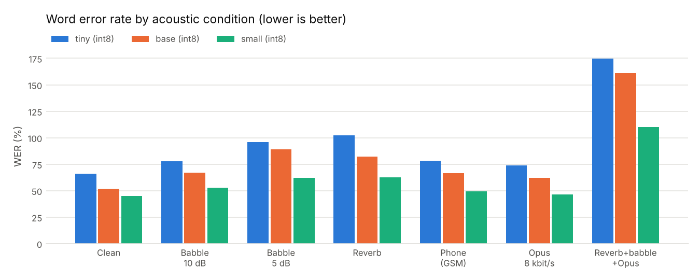
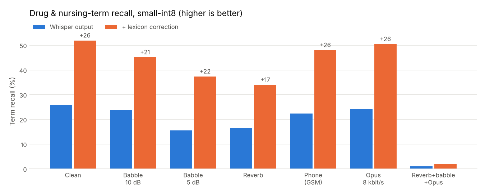
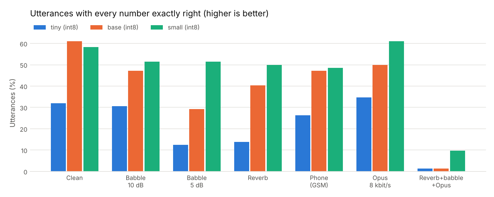

# care-stt — German speech-to-text for care documentation, tested under real-world conditions

Caregivers dictate notes like *"Blutdruck 139 zu 69, Puls 53"* or *"Ramipril 5 Milligramm um acht Uhr gegeben"* on a phone, in a busy corridor, over a weak connection. For that use, overall WER is not the number that matters most. What matters is whether the **drug name, the dose and the vital sign land in the chart correctly**, and what happens when they don't.

This project measures exactly that for off-the-shelf Whisper models and adds three layers that make the output safer to use:

1. **A field-condition benchmark** — 7 acoustic conditions (ward babble, reverb, GSM phone line, Opus 8 kbit/s, combined), 3 model sizes, int8 vs fp32, scored on WER plus **drug/nursing-term recall** and **exact-number accuracy**, with bootstrap confidence intervals.
2. **Lexicon post-correction** — snaps misheard drug and nursing terms ("Ramibril", "Rami Pril" → *Ramipril*; "Hiparin" → *Heparin*) using spelling + German phonetic similarity (Kölner Phonetik), with a threshold tuned on a held-out dev split.
3. **Chart extraction with review flags** — vitals and doses are parsed into fields; implausible, inconsistent or half-heard values are **flagged for the caregiver to confirm** instead of being filed silently.

Everything runs on CPU through ONNX Runtime ([sherpa-onnx](https://github.com/k2-fsa/sherpa-onnx)), the same runtime used for Whisper on Android/iOS, so the latency numbers are a meaningful proxy for on-device inference.

## Results (test split: 81 unseen sentences × 2 unseen voices = 162 utterances per condition)

Full tables: [`results/report.md`](results/report.md) · raw numbers: [`results/metrics.json`](results/metrics.json)

| | tiny-int8 | base-int8 | small-int8 |
|---|---|---|---|
| WER, clean (95% CI) | 66.0% (61.0–71.5) | 51.9% (47.1–56.9) | **44.8%** (40.2–49.4) |
| Drug/term recall, raw → **corrected** | 9.2% → **34.9%** | 18.4% → **48.5%** | 25.7% → **51.9%** |
| Correction precision (test) | 94.6% | 95.4% | 96.4% |
| Utterances with every number right | 31.9% | **61.1%** | 58.3% |
| Model size | 103 MB | 160 MB | 375 MB |
| Real-time factor, 2 threads (idle VM) | 0.15 | 0.25 | 0.83 |

**Key findings**

- **Lexicon correction is the biggest single gain.** On whisper-small it lifts drug/term recall from 25.7% to 51.9%. The paired bootstrap 95% CI of the gain is +20.5 to +32.6 points. Precision of its edits is 93–98% across every condition except the combined worst case. The threshold (0.75) was chosen on the dev split only (different sentences, different voices), where it reached 99.5% precision.
- **WER hides the safety picture.** Whisper writes compound German numbers digit by digit ("neunundsechzig" → "9 und 60"), reads "Puls" as "Hools", or drops the first syllable of "Blutdruck". These are single-word errors in WER but lost chart fields.
- **Silent errors stay rare.** With small-int8 on clean audio, only **1.4% of gold vitals/dose fields were written wrong without a review flag**. Of all wrong values, 91.7% landed in a note flagged for review. Correction raises fully-correct fields from 18.8% to 28.3%, at the cost of those 2 unflagged errors out of 138 fields. That trade-off is shown openly in the report.
- **int8 is the right deployment default.** Quantising whisper-small cuts it from 969 MB to 375 MB and decodes ~17% faster. The clean-WER difference (44.8% vs 42.1%) lies inside overlapping confidence intervals.
- **Robustness ranking.** Opus 8 kbit/s and GSM cost little; 5 dB babble and reverb cost the most (small-int8 WER 44.8% → 62%). The **combined** condition (reverb + 10 dB babble + Opus) breaks every model (WER > 100%, hallucinated text). A production system needs an audio-quality check that asks the user to repeat, which is listed under next steps.
- **Recommended split:** base-int8 on-device (RTF 0.25, p95 1.2 s for a 4 s note, best number accuracy), small-int8 server-side for difficult audio.





### What the corrector does (real test outputs, base-int8, clean)

| Whisper heard | Corrected to | Score |
|---|---|---|
| Rami Pril | Ramipril | 1.00 |
| Hiparin | Heparin | 0.93 |
| Lehwo Dopa | Levodopa | 0.89 |
| Apigsaban | Apixaban | 0.89 |
| dekubite Sprophylaxe | Dekubitusprophylaxe | 0.97 |
| Kontinens Material | Inkontinenzmaterial | 0.84 |
| Sauerstoff-Settigung | Sauerstoffsättigung | 0.97 |
| Lutdruck | Blutdruck | 0.84 |

Every change is returned by the API (`corrections: [{heard, replaced_with, score}]`), so nothing is rewritten invisibly.

**Known failure modes.** These are kept visible so they don't hide in an average:

- Past participles still get pulled to a noun ("erbrochen" → "Erbrechen").
- Merged words can absorb a neighbour ("als Bedarfsmedikation" → "Bedarfsmedikation").
- Split drug names starting with a function word ("am lodipa" → Amlodipin) are deliberately not merged. Allowing it caused false corrections.

## How it works

```
audio ──► [Silero VAD if > 25 s] ──► Whisper (ONNX, int8) ──► raw transcript
                                                                     │
          German normaliser (numbers, units, "130/80", "9 und 60") ◄─┘  (for scoring + extraction)
                                                                     │
          lexicon corrector (Levenshtein + Kölner Phonetik, θ=0.75) ◄─┘
                                                                     │
          extraction: vitals + doses ──► plausibility / consistency / missing-value / unknown-drug flags
                                                                     │
                                         JSON: transcript, corrections, fields, review flags, timing
```

| Module | Purpose |
|---|---|
| `care_stt/normalize.py` | German number words → digits (incl. *zweieinhalb*, *siebenunddreißig komma acht*), units, BP formats, Whisper's split compounds. Applied identically to reference and hypothesis, with tests proving it never hides a real error (`"Puls 72" ≠ "22 und 70"`). |
| `care_stt/metrics.py` | WER/CER (jiwer), term recall, number recall, all-numbers-right rate, hallucinated numbers |
| `care_stt/correct.py` | Lexicon corrector: 1–3 word spans, Kölner Phonetik, stop-word and inflection guards |
| `care_stt/extract.py` | Vitals (BP, pulse, temperature, SpO₂, glucose, respiratory rate) and doses; review flags; scoring that separates **silent** from **flagged** errors |
| `care_stt/degrade.py` | Deterministic acoustic conditions: babble from other talkers at set SNR, synthetic RIR reverb, 300–3400 Hz + GSM codec, Opus 8 kbit/s |
| `care_stt/asr.py` | Whisper via sherpa-onnx (int8/fp32), Silero VAD segmentation for long recordings |
| `care_stt/service.py` | FastAPI `POST /transcribe` (any sample rate, resampled), `GET /health` |
| `care_stt/gates.py` + `gates.yaml` | Release gates: block a change that regresses WER, term recall, correction precision, silent-error rate, numbers or latency |

## Evaluation design

- **Corpus** (`data/corpus.jsonl`): 120 German care notes using 33 of the 44 drugs and 35 of the 37 nursing terms in `data/lexicon.txt`. 70 are hand-written free-text notes (wound care, falls, prophylaxis, medication). 50 are templated dictations with gold structured fields (vitals, doses, times). Split 1/3 dev, 2/3 test.
- **Speakers**: six German Piper (VITS) voices. Four are used for dev, and two are **held out for test**, with test speaking rate randomised 0.9–1.15×.
- **No leakage**: babble is built from *other* sentences spoken by *dev* voices, so the interfering speech never contains the target sentence or speaker.
- **Tuned on dev, reported on test**: the correction threshold is the only fitted parameter. Normalisation and extraction rules were written from error analysis of transcripts, and that is stated here rather than presented as untouched.
- **Uncertainty**: 1,000-sample bootstrap CIs over utterances. The correction gain is measured **paired** (same resample, raw vs corrected).
- **Latency**: measured separately on an idle 2-vCPU VM (`scripts/latency.py`), 30 clips, after warm-up, at 1 and 2 threads.

## Limitations (read before quoting numbers)

- **Synthetic speech.** Test audio is TTS with simulated acoustics, not recordings of caregivers. Absolute WERs are not comparable to real-speech benchmarks. Use them to compare models, conditions and post-processing, not to predict field accuracy.
- **One weak voice.** The `ramona-low` voice is much less intelligible than the other five (small-int8 clean WER 58.0% vs 31.6% for `pavoque-low`), which inflates averages. Per-voice numbers are in `results/report.md`.
- **Short, term-dense utterances.** Most notes are 6–12 words, and many words are drug or nursing terms, so one miss moves WER a lot.
- **Randomised doses.** Template doses are drawn at random for number coverage and are not clinically meaningful (e.g. "Amlodipin 500 Milligramm").
- **No fine-tuning yet.** All models are off-the-shelf. The corrector is post-processing, not model adaptation.

`scripts/eval_recordings.py` runs the same metrics on **real recordings** (any folder of audio + `.txt` references: phone dictations, FLEURS-de, Common Voice). That is the next validation step.

## Next steps

1. Real-speech validation: FLEURS German + a set of real dictated care notes (including non-native German speakers, common in care staff).
2. Audio-quality gate before decoding (SNR / speech-ratio estimate + decoder confidence) to ask for a repeat instead of filing a hallucinated note.
3. Contextual biasing during decoding (prompting / hotwords with the facility's medication plan), compared against post-correction.
4. LoRA fine-tuning of whisper-small on domain text-to-speech + real data, evaluated with the same gates.
5. Per-drug dose-range checks in the extraction layer.

## Run it

```bash
pip install -r requirements.txt            # + ffmpeg on PATH
scripts/download_models.sh                 # Whisper tiny/base/small, 6 German voices, Silero VAD (GitHub releases)
python scripts/build_corpus.py             # deterministic corpus + split
scripts/run_all.sh                         # full grid (~3 h on 2 CPU cores)
python scripts/latency.py --models tiny-int8 base-int8 small-int8
python scripts/evaluate.py                 # metrics.json, report.md, charts
python -m care_stt.gates                   # release gates
pytest -q                                  # 61 tests (model tests skip if weights absent)

# service
uvicorn care_stt.service:app --port 8000
curl -F audio=@note.wav localhost:8000/transcribe

# your own recordings
python scripts/eval_recordings.py data/recordings --models base-int8 small-int8
```

CI (`.github/workflows/ci.yml`) runs the unit tests and then a smoke evaluation with real models: whisper-tiny on 20 sentences × 2 voices × 3 conditions. It fails on a broken pipeline and checks the release gates against the committed benchmark.

## Licences

Code: MIT. Models are downloaded at run time and keep their own licences: Whisper (MIT), Piper voices (see each voice's `MODEL_CARD`), Silero VAD (MIT).
