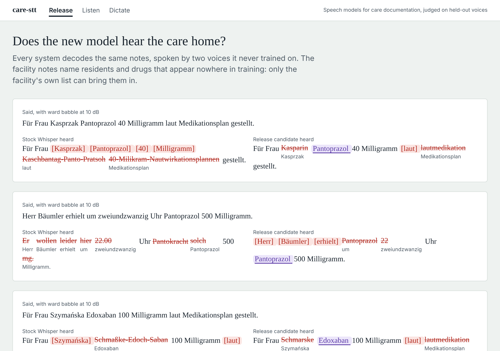
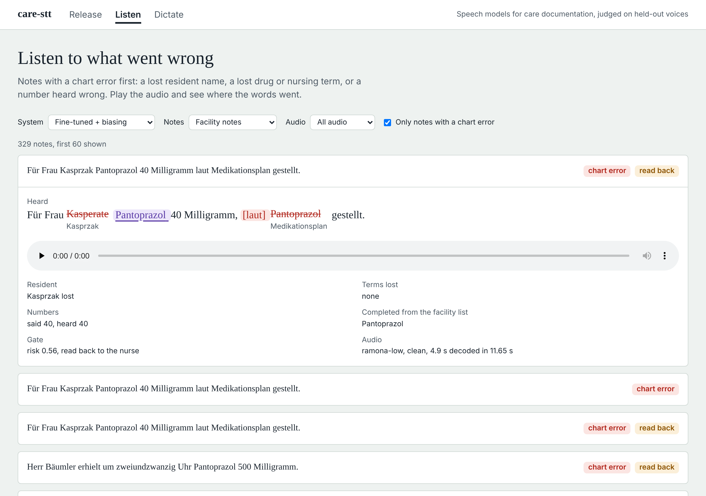

# care-stt — German speech-to-text for care documentation

Caregivers dictate notes like *"Für Frau Kasprzak Pantoprazol 40 Milligramm laut Medikationsplan gestellt"* on a phone, in a busy corridor. What matters is not overall WER. It is whether **the resident, the drug and the dose land in the chart correctly**, and what happens when they don't.

**v2 (Nov 2026)** goes from measuring off-the-shelf Whisper to changing it:

1. **Whisper rebuilt in PyTorch from the ONNX graphs the phone runs.** The encoder and the KV-cached decoder match sherpa-onnx's own graphs (logits within 5e-5), so a model trained here can be exported back into the same runtime.
2. **Decoder fine-tuning on care dictation.** The encoder stays frozen and the training runs on CPU. Training text has its own drugs and names, kept apart from every test set.
3. **Facility-list biasing while decoding.** A prefix trie over the facility's residents and medication plan adds a bonus per matching token and takes it back if the match breaks (shallow fusion). The bonus strength was tuned on a dev facility.
4. **Export back to the phone format.** The result is ONNX with int8 MatMul weights (129.6 MB decoder, vs 130.7 MB for sherpa's own), and it loads unchanged in sherpa-onnx.
5. **A read-back gate.** A logistic regression over the decoder's own signals (token log-probabilities, speaking rate, length, repetition) decides whether a note is filed as heard or read back to the nurse first.
6. **A review console** (React) to compare releases, listen to the failures and dictate a note.

Everything runs on 2 CPU cores, with no GPU and no Hugging Face access. Models come from the sherpa-onnx GitHub releases.

## v2 results

All test numbers are from **two voices never used in training or tuning**, under clean audio and 10 dB ward babble. Raw numbers: [`results/v2/metrics.json`](results/v2/metrics.json), [`results/v2/gate.json`](results/v2/gate.json), [`results/v2/phone_runtime.json`](results/v2/phone_runtime.json). Release gates: [`gates_v2.yaml`](gates_v2.yaml) (23/23 pass).

### Facility notes: residents and drugs the model never saw (whisper-base, 480 decodes per system)

Three test facilities, each with 12 residents and a 10-drug medication plan. *Unseen lexicon drugs* are in the care lexicon but in no training sentence. *Brand-new drugs* are in no list at all, only in the facility's plan.

| | Stock Whisper | Stock + facility list | Fine-tuned | **Fine-tuned + facility list** |
|---|---|---|---|---|
| WER | 69.5% | 57.2% | 59.1% | 58.5% |
| Drug and nursing-term recall | 7.8% | 36.4% | 21.4% | **52.5%** |
| Resident names heard | 15.8% | **63.5%** | 13.1% | 60.8% |
| Unseen lexicon drugs | 5.4% | 37.8% | 1.0% | **39.2%** |
| Brand-new drugs | 4.3% | 34.8% | 6.1% | **42.7%** |
| Chart fields fully correct | 9.4% | 24.7% | 27.6% | **49.2%** |
| Chart fields wrong and not flagged | **1.5%** | **1.0%** | 2.6% | 2.8% |
| Real-time factor (2 threads, mean / p95) | 0.20 / 0.27 | 0.79 / 1.01 | 0.17 / 0.21 | 0.71 / 1.57 |

### Hand-written care notes from v1 (81 notes, greedy decoding, 324 decodes per system)

| | Stock Whisper | Fine-tuned |
|---|---|---|
| WER | 58.8% | **31.7%** |
| Drug and nursing-term recall | 16.8% | **68.2%** |
| Notes with every number right | 56.9% | **79.9%** |
| Chart fields fully correct | 13.0% | **73.2%** |
| Chart fields wrong and not flagged | **1.8%** | 3.6% |

### What the numbers say

- **Fine-tuning fixes the care vocabulary the model was trained on, not what it wasn't.** On v1's notes, WER halves (58.8% → 31.7%) and term recall goes from 17% to 68%. On the facility notes, fine-tuning alone barely helps names (13%) and unseen drugs (1%). Those words come only from the facility list.
- **The facility list is what brings in new names and drugs**, about four times the name recall and eight times the drug recall of stock. The two methods work best together: fine-tuned + list gets 49% of chart fields fully right, vs 25% for stock + list and 9% for stock.
- **Two regressions, held as gates rather than hidden.**
  - Unflagged wrong fields rise from 1.5% (stock) to 2.8%. The fine-tuned model writes more numbers and fields, and some are wrong.
  - Stock + list hears slightly more resident names (63.5% vs 60.8%).
  - `gates_v2.yaml` holds both as ceilings, so they cannot get worse unnoticed.
- **Biasing costs CPU.** Beam search with the list runs at about 4× the greedy cost, and its p95 is above real time on this VM with a Python loop. On a phone it needs the C++ decoding loop or a smaller beam.

### Read-back gate (fine-tuned + facility list, 480 test notes)

| | |
|---|---|
| Notes with at least one chart error (strict: any lost term, name or number) | 68.5% |
| Notes the gate reads back | 78.5% |
| Erroneous notes caught | 86.6% |
| Notes filed with an error and no read-back | 68.5% → **9.2%** |

The threshold was set on dev notes for 80% recall, and it held on test (86.6%). Honest reading: with errors in two thirds of notes on this synthetic speech, the gate mostly decides which fifth of notes it can safely skip. It is the right shape for a product, and it needs real recordings to show whether it skips much more.

### Same decoder, unchanged phone runtime (sherpa-onnx 1.12, int8, 40 test notes)

| | Stock decoder | Fine-tuned decoder |
|---|---|---|
| WER in sherpa-onnx | 79.5% | **61.2%** |
| Term recall in sherpa-onnx | 4.2% | **22.9%** |
| Term recall in this repo's decoding loop | 6.3% | 22.9% |
| Real-time factor, 1 / 2 threads | 0.21 / 0.15 | 0.16 / 0.11 |
| Encoder + decoder size (int8) | 159.8 MB | 158.7 MB |

The exported decoder is a drop-in replacement: sherpa-onnx loads it unchanged and gets the same term recall as the Python loop. The two runtimes agree on the exact text of only 13% of notes. That is most likely because their feature front ends differ (Python log-mel vs sherpa's C++ fbank). The model graphs themselves match (tests below). The fine-tuned decoder is also faster in sherpa-onnx, probably because it produces fewer runaway outputs.




## v2: how it works

```
facility list (residents, medication plan) ─────────────┐
                                                        ▼
audio ─► log-mel ─► Whisper encoder (int8, stock) ─► fine-tuned decoder (int8) + prefix-trie biasing, beam 4
                                                        │
              per-token log-probs, rate, length ─► read-back gate ─► file as heard | read back to the nurse
                                                        │
                                   v1 layers: normaliser, lexicon corrector, field extraction and flags
```

| Module | Purpose |
|---|---|
| `care_stt/torch_whisper.py` | Whisper in PyTorch, with weights taken from sherpa-onnx's ONNX graphs. Whisper log-mel, BPE tokenizer (tiktoken-compatible), KV-cached incremental decoding |
| `care_stt/corpus2.py` | Training dictations, three test facilities and one dev facility. Drug and name splits, checked disjoint by tests |
| `care_stt/train.py` | Decoder fine-tuning (AdamW, warmup and linear decay, fresh acoustic condition per epoch, early stopping on dev) |
| `care_stt/export.py` | Export to sherpa's decoder interface, folding weight transposes, int8 dynamic quantisation |
| `care_stt/runtime.py` | ONNX Runtime decoding: greedy or beam, facility-list biasing (`BiasTree`), per-token log-probs |
| `care_stt/eval2.py`, `gate.py`, `gates_v2.py` | Benchmark, read-back gate, release gates |
| `care_stt/review_api.py` + `console/` | FastAPI review API and the React console (Vite, Tailwind, Framer Motion, Playwright + axe) |

### v2 evaluation design

- **Splits.**
  - Training text uses its own drugs and resident names.
  - 12 lexicon drugs and 16 brand-new drugs appear only in test facilities.
  - The test facilities' residents never appear in training.
  - The dev facility ("Haus Sonnenhang") is disjoint from all three test facilities.
  - Training sentences share no 6-gram with v1's test notes.
  - `tests/test_v2_units.py` checks all of this.
- **Voices.** Training and every tuning choice (early stopping, bias strength, gate threshold) use dev voices only. Test numbers use the two held-out voices.
- **Tuned on dev.** The bias bonus (3.0) was picked on the dev facility: the most names and drugs recovered without raising WER by more than two points. A bonus of 4 tripled WER on dev.
- **Parity tests** (`tests/test_models_v2.py`):
  - the PyTorch port matches sherpa's ONNX graphs;
  - incremental decoding equals teacher forcing;
  - the exported decoder matches sherpa's own (logits within 1.3e-5, identical caches);
  - the BPE tokenizer matches Whisper's own tokens.

### v2 limitations

- **Synthetic speech.** All audio is Piper TTS with simulated acoustics. Absolute numbers will not match real dictation, and the next step is real recordings (`scripts/eval_recordings.py` already runs the same metrics on any folder).
- **One training run, no confidence intervals for v2 yet.** Training took 51 minutes on 2 CPUs. The best checkpoint came at step 240 of 600, and the model overfits after the first epoch.
- **Trimmed test grid.** Clean and 10 dB babble only. Phone-line, reverb and Opus were dropped from v2's test to fit the CPU budget (v1 covers them for stock models).
- **Biasing in Python.** The trie biasing runs in this repo's decoding loop, not inside sherpa-onnx. On a phone it would be ported to the native loop.
- **whisper-base only.** The training and export path also runs for tiny (CI does it). small was not trained here.

## v2: run it

```bash
pip install -r requirements.txt                    # torch from the CPU index; ffmpeg on PATH
scripts/download_models.sh                         # sherpa-onnx Whisper + Piper voices (GitHub releases)
python -m care_stt.corpus2                         # training text, facility test and dev sets
python -m care_stt.train --size base --epochs 3    # ~50 min on 2 CPUs
python scripts/v2_benchmark.py export --run ~/models/finetuned/base-care-XXXX
python scripts/v2_benchmark.py tune && python scripts/v2_benchmark.py dev
python scripts/v2_benchmark.py test && python scripts/v2_benchmark.py report
python scripts/v2_phone_runtime.py
python -m care_stt.gates_v2                        # 23 release gates
pytest -q                                          # 71 tests
uvicorn care_stt.review_api:app --port 8000        # API + console (cd console && npm ci && npm run build)
cd console && CARE_STT_CONSOLE=http://localhost:8000 npm run e2e   # 12 Playwright tests incl. axe, both themes, phone width
```

CI runs the unit tests and both release gates. It also runs the model tests, a 20-sentence smoke evaluation and a tiny end-to-end fine-tune with real models, plus the console build and its end-to-end tests.

## v1: field-condition benchmark of stock Whisper, lexicon correction, chart extraction (Oct 2026)

v1 measured off-the-shelf Whisper (tiny, base and small; int8 vs fp32) under 7 acoustic conditions. It added a lexicon corrector (Levenshtein + Kölner Phonetik) and chart extraction with review flags. Its release gates (`gates.yaml`, 9/9) still run in CI.

### v1 results (test split: 81 unseen sentences × 2 unseen voices = 162 utterances per condition)

Full tables: [`results/report.md`](results/report.md) · raw numbers: [`results/metrics.json`](results/metrics.json)

| | tiny-int8 | base-int8 | small-int8 |
|---|---|---|---|
| WER, clean (95% CI) | 66.0% (61.0–71.5) | 51.9% (47.1–56.9) | **44.8%** (40.2–49.4) |
| Drug/term recall, raw → **corrected** | 9.2% → **34.9%** | 18.4% → **48.5%** | 25.7% → **51.9%** |
| Correction precision (test) | 94.6% | 95.4% | 96.4% |
| Utterances with every number right | 31.9% | **61.1%** | 58.3% |
| Model size | 103 MB | 160 MB | 375 MB |
| Real-time factor, 2 threads (idle VM) | 0.15 | 0.25 | 0.83 |

**Key findings**

- **Lexicon correction is the biggest single gain.** On whisper-small it lifts drug/term recall from 25.7% to 51.9%. The paired bootstrap 95% CI of the gain is +20.5 to +32.6 points. Precision of its edits is 93–98% across every condition except the combined worst case. The threshold (0.75) was chosen on the dev split only (different sentences, different voices), where it reached 99.5% precision.
- **WER hides the safety picture.** Whisper writes compound German numbers digit by digit ("neunundsechzig" → "9 und 60"), reads "Puls" as "Hools", or drops the first syllable of "Blutdruck". These are single-word errors in WER but lost chart fields.
- **Silent errors stay rare.** With small-int8 on clean audio, only **1.4% of gold vitals/dose fields were written wrong without a review flag**. Of all wrong values, 91.7% landed in a note flagged for review. Correction raises fully-correct fields from 18.8% to 28.3%, at the cost of those 2 unflagged errors out of 138 fields. That trade-off is shown openly in the report.
- **int8 is the right deployment default.** Quantising whisper-small cuts it from 969 MB to 375 MB and decodes ~17% faster. The clean-WER difference (44.8% vs 42.1%) lies inside overlapping confidence intervals.
- **Robustness ranking.** Opus 8 kbit/s and GSM cost little; 5 dB babble and reverb cost the most (small-int8 WER 44.8% → 62%). The **combined** condition (reverb + 10 dB babble + Opus) breaks every model (WER > 100%, hallucinated text). A production system needs an audio-quality check that asks the user to repeat, which is listed under next steps.
- **Recommended split:** base-int8 on-device (RTF 0.25, p95 1.2 s for a 4 s note, best number accuracy), small-int8 server-side for difficult audio.


#### What the corrector does (real test outputs, base-int8, clean)

| Whisper heard | Corrected to | Score |
|---|---|---|
| Rami Pril | Ramipril | 1.00 |
| Hiparin | Heparin | 0.93 |
| Lehwo Dopa | Levodopa | 0.89 |
| Apigsaban | Apixaban | 0.89 |
| dekubite Sprophylaxe | Dekubitusprophylaxe | 0.97 |
| Kontinens Material | Inkontinenzmaterial | 0.84 |
| Sauerstoff-Settigung | Sauerstoffsättigung | 0.97 |
| Lutdruck | Blutdruck | 0.84 |

Every change is returned by the API (`corrections: [{heard, replaced_with, score}]`), so nothing is rewritten invisibly.

**Known failure modes.** These are kept visible so they don't hide in an average:

- Past participles still get pulled to a noun ("erbrochen" → "Erbrechen").
- Merged words can absorb a neighbour ("als Bedarfsmedikation" → "Bedarfsmedikation").
- Split drug names starting with a function word ("am lodipa" → Amlodipin) are deliberately not merged. Allowing it caused false corrections.

### v1: How it works

```
audio ──► [Silero VAD if > 25 s] ──► Whisper (ONNX, int8) ──► raw transcript
                                                                     │
          German normaliser (numbers, units, "130/80", "9 und 60") ◄─┘  (for scoring + extraction)
                                                                     │
          lexicon corrector (Levenshtein + Kölner Phonetik, θ=0.75) ◄─┘
                                                                     │
          extraction: vitals + doses ──► plausibility / consistency / missing-value / unknown-drug flags
                                                                     │
                                         JSON: transcript, corrections, fields, review flags, timing
```

| Module | Purpose |
|---|---|
| `care_stt/normalize.py` | German number words → digits (incl. *zweieinhalb*, *siebenunddreißig komma acht*), units, BP formats, Whisper's split compounds. Applied identically to reference and hypothesis, with tests proving it never hides a real error (`"Puls 72" ≠ "22 und 70"`). |
| `care_stt/metrics.py` | WER/CER (jiwer), term recall, number recall, all-numbers-right rate, hallucinated numbers |
| `care_stt/correct.py` | Lexicon corrector: 1–3 word spans, Kölner Phonetik, stop-word and inflection guards |
| `care_stt/extract.py` | Vitals (BP, pulse, temperature, SpO₂, glucose, respiratory rate) and doses; review flags; scoring that separates **silent** from **flagged** errors |
| `care_stt/degrade.py` | Deterministic acoustic conditions: babble from other talkers at set SNR, synthetic RIR reverb, 300–3400 Hz + GSM codec, Opus 8 kbit/s |
| `care_stt/asr.py` | Whisper via sherpa-onnx (int8/fp32), Silero VAD segmentation for long recordings |
| `care_stt/service.py` | FastAPI `POST /transcribe` (any sample rate, resampled), `GET /health` |
| `care_stt/gates.py` + `gates.yaml` | Release gates: block a change that regresses WER, term recall, correction precision, silent-error rate, numbers or latency |

### v1: Evaluation design

- **Corpus** (`data/corpus.jsonl`): 120 German care notes using 33 of the 44 drugs and 35 of the 37 nursing terms in `data/lexicon.txt`. 70 are hand-written free-text notes (wound care, falls, prophylaxis, medication). 50 are templated dictations with gold structured fields (vitals, doses, times). Split 1/3 dev, 2/3 test.
- **Speakers**: six German Piper (VITS) voices. Four are used for dev, and two are **held out for test**, with test speaking rate randomised 0.9–1.15×.
- **No leakage**: babble is built from *other* sentences spoken by *dev* voices, so the interfering speech never contains the target sentence or speaker.
- **Tuned on dev, reported on test**: the correction threshold is the only fitted parameter. Normalisation and extraction rules were written from error analysis of transcripts, and that is stated here rather than presented as untouched.
- **Uncertainty**: 1,000-sample bootstrap CIs over utterances. The correction gain is measured **paired** (same resample, raw vs corrected).
- **Latency**: measured separately on an idle 2-vCPU VM (`scripts/latency.py`), 30 clips, after warm-up, at 1 and 2 threads.

### v1: Limitations (read before quoting numbers)

- **Synthetic speech.** Test audio is TTS with simulated acoustics, not recordings of caregivers. Absolute WERs are not comparable to real-speech benchmarks. Use them to compare models, conditions and post-processing, not to predict field accuracy.
- **One weak voice.** The `ramona-low` voice is much less intelligible than the other five (small-int8 clean WER 58.0% vs 31.6% for `pavoque-low`), which inflates averages. Per-voice numbers are in `results/report.md`.
- **Short, term-dense utterances.** Most notes are 6–12 words, and many words are drug or nursing terms, so one miss moves WER a lot.
- **Randomised doses.** Template doses are drawn at random for number coverage and are not clinically meaningful (e.g. "Amlodipin 500 Milligramm").
- **No fine-tuning yet.** All models are off-the-shelf. The corrector is post-processing, not model adaptation.

`scripts/eval_recordings.py` runs the same metrics on **real recordings** (any folder of audio + `.txt` references: phone dictations, FLEURS-de, Common Voice). That is the next validation step.

### v1: next steps (written in Oct 2026; v2 did 2, 3 and a decoder-only version of 4)

1. Real-speech validation: FLEURS German + a set of real dictated care notes (including non-native German speakers, common in care staff).
2. Audio-quality gate before decoding (SNR / speech-ratio estimate + decoder confidence) to ask for a repeat instead of filing a hallucinated note.
3. Contextual biasing during decoding (prompting / hotwords with the facility's medication plan), compared against post-correction.
4. LoRA fine-tuning of whisper-small on domain text-to-speech + real data, evaluated with the same gates.
5. Per-drug dose-range checks in the extraction layer.

### v1: run it

```bash
pip install -r requirements.txt            # + ffmpeg on PATH
scripts/download_models.sh                 # Whisper tiny/base/small, 6 German voices, Silero VAD (GitHub releases)
python scripts/build_corpus.py             # deterministic corpus + split
scripts/run_all.sh                         # full grid (~3 h on 2 CPU cores)
python scripts/latency.py --models tiny-int8 base-int8 small-int8
python scripts/evaluate.py                 # metrics.json, report.md, charts
python -m care_stt.gates                   # release gates
pytest -q                                  # model tests skip if weights absent

# service
uvicorn care_stt.service:app --port 8000
curl -F audio=@note.wav localhost:8000/transcribe

# your own recordings
python scripts/eval_recordings.py data/recordings --models base-int8 small-int8
```

CI (`.github/workflows/ci.yml`) runs the unit tests and then a smoke evaluation with real models: whisper-tiny on 20 sentences × 2 voices × 3 conditions. It fails on a broken pipeline and checks the release gates against the committed benchmark.

## Licences

Code: MIT. Models are downloaded at run time and keep their own licences: Whisper (MIT), Piper voices (see each voice's `MODEL_CARD`), Silero VAD (MIT).
